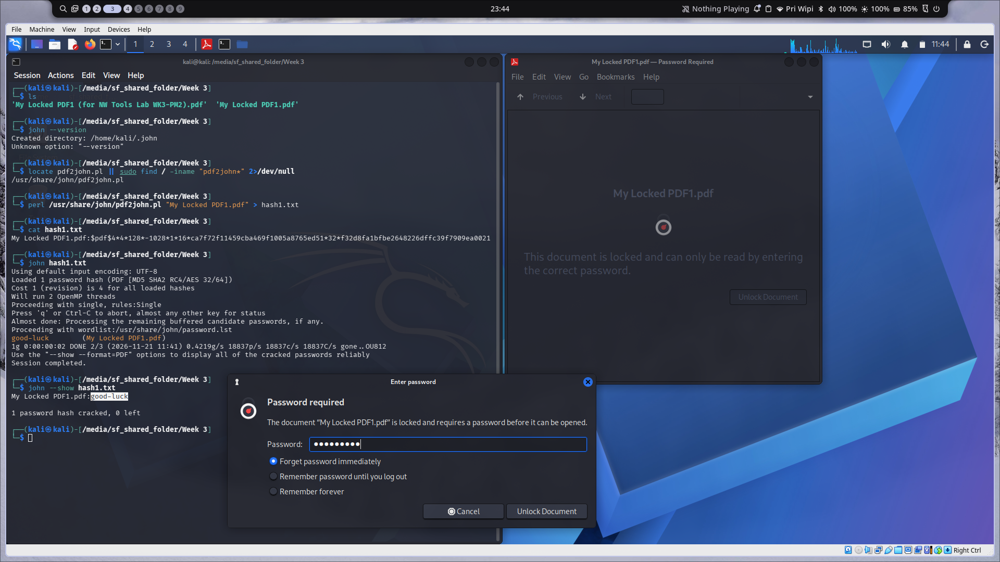
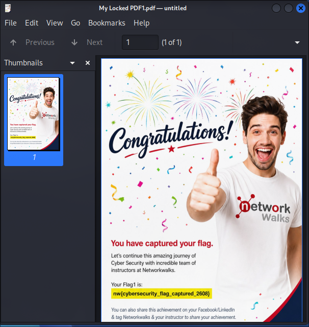
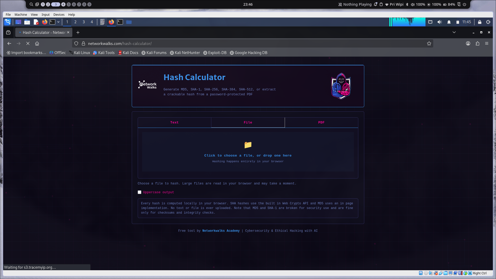
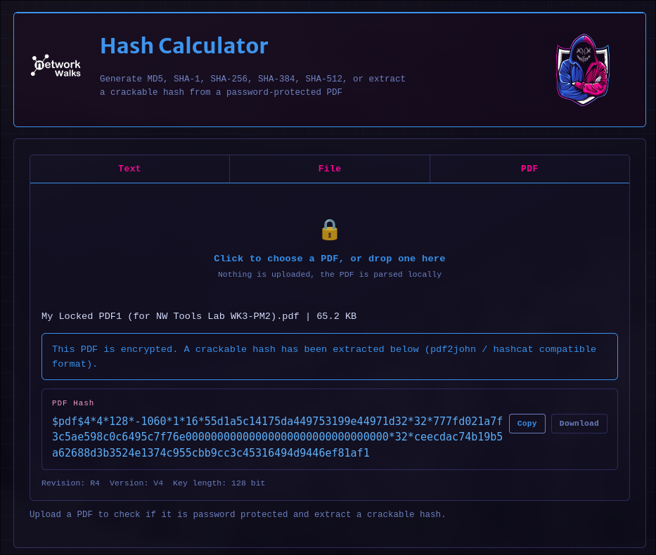
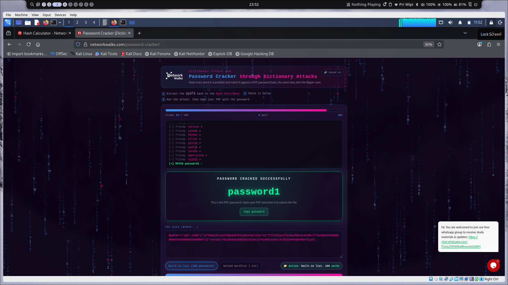
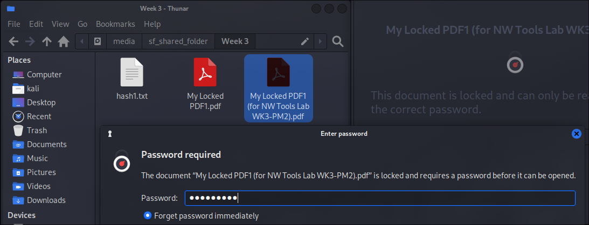
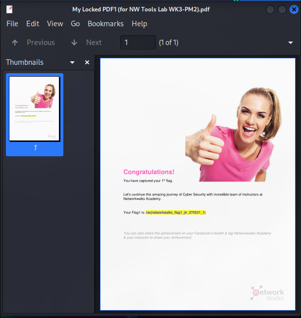

Password Cracking with JTR & Networkwalks Tools (WK3: W3-PM1, W3-PM2)
======================================================================

**Recovering the password of an encrypted PDF file using John the Ripper / Johnny on Kali Linux, and using Networkwalks' own browser-based Hash Calculator & Password Cracker**

*   **Student:** Fauzan Putra Ramadhan (Batch B084D)
*   **Host OS:** Fedora Workstation (Linux)
*   **Attacker VM:** Kali Linux (VirtualBox), built in WK1-PM1
*   **Report date:** 22 November 2026

* * *

📌 Project Overview
-------------------

| Module | Type | Topic | Status |
|---|---|---|---|
| W3-PM1 | Essential | Password cracking with John the Ripper (JTR CLI, pre-installed in Kali) | Done |
| W3-PM2 | Essential | Password cracking with Networkwalks' Hash Calculator & Password Cracker (browser-based) | Done |

**Scope.** Both modules target the same type of lab file: a password-protected sample PDF provided by Networkwalks for this exercise (`My Locked PDF1.pdf` for W3-PM1, and a separate copy `My Locked PDF1 (for NW Tools Lab WK3-PM2).pdf` for W3-PM2). No files outside the lab materials were touched. This is an authorized, educational password-auditing exercise, not an attack on a third party.

* * *

🧰 Tools Used
-------------

| Tool | Purpose |
|---|---|
| `john` (John the Ripper, Jumbo CLI, pre-installed in Kali) | Offline dictionary attack against the extracted PDF hash |
| `pdf2john.pl` (`/usr/share/john/pdf2john.pl`) | Extract a crackable `$pdf$...` hash from the encrypted PDF |
| Johnny | GUI front-end for John the Ripper (optional, same engine as the CLI) |
| [Networkwalks Hash Calculator](https://networkwalks.com/hash-calculator/) | Browser tool that parses a locked PDF locally and extracts its `$pdf$...` hash (no upload) |
| [Networkwalks Password Cracker](https://networkwalks.com/password-cracker/) | Browser tool that runs a dictionary attack against a pasted `$pdf$...` hash |

* * *

🎯 Part 1. Password Cracking with John the Ripper (W3-PM1)
------------------------------------------------------------

The lab module is written for Windows (download John + Johnny, extract the hash via a third-party website). Since the attacker machine here is Kali Linux, I used the note in the module itself: *"If you are using Kali Linux then you can open JTR (John The Ripper) directly because it comes pre-installed in Kali Linux."* So instead of the Windows flow, I ran `john` and `pdf2john.pl` natively from the terminal.

### Step 1. Extract the hash from the locked PDF

    locate pdf2john.pl || sudo find / -iname "pdf2john*" 2>/dev/null
    perl /usr/share/john/pdf2john.pl "My Locked PDF1.pdf" > hash1.txt
    cat hash1.txt

Result (hash format, first few characters shown, rest truncated for this report):

    My Locked PDF1.pdf:$pdf$4*4*128*-1028*1*16*ca7f72f1...*32*f32d8fa1bfbe2648226dffc39f7909ea0021

### Step 2. Run the dictionary attack

    john hash1.txt

John loaded the hash (`PDF [MD5 SHA2 RC4/AES 32/64]`) and cracked it against the default wordlist (`/usr/share/john/password.lst`) in about 2 seconds.

### Step 3. Show the cracked password

    john --show hash1.txt

**Result:** `My Locked PDF1.pdf:go*d-l*ck` — password recovered: **`go*d-l*ck`** (masked, 9 characters, all lowercase + one hyphen).

### Step 4. Open the PDF with the recovered password

The PDF opened successfully in the default PDF viewer after entering the cracked password. The unlocked document displayed a congratulations page with a capture-the-flag string:

    nw{cybersecurity_flag_c*******_****}

(flag partially masked in this report)

* * *

🌐 Part 2. Password Cracking with Networkwalks Tools (W3-PM2)
-----------------------------------------------------------------

This module uses two free browser tools built by Networkwalks instead of a local CLI. Everything runs client-side in the browser (no file or hash is uploaded to a server). The module explicitly allows doing this on Kali Linux, since both tools just need a web browser.

### Step 1. Open the Hash Calculator and select the PDF tab

`https://networkwalks.com/hash-calculator/` has three input tabs: **Text**, **File**, and **PDF**. The **Text**/**File** tabs only compute generic checksums (MD5, SHA-1, SHA-256, SHA-384, SHA-512) and are *not* what this lab needs — I initially picked the wrong tab and got five generic hash lines instead of a `$pdf$...` hash. The correct tab is **PDF**, which parses a locked PDF locally and extracts a `pdf2john`/`hashcat`-compatible hash.

### Step 2. Upload the locked PDF and copy the extracted hash

Uploaded `My Locked PDF1 (for NW Tools Lab WK3-PM2).pdf` to the **PDF** tab. The tool detected it as encrypted and returned a crackable hash:

    $pdf$4*4*128*-1060*1*16*55d1a5c1...*32*ceecdac74b19b5a62688d3b3524e1374c955cbb9cc3c45316494d9446ef81af1

Revision 4, Version 4, key length 128-bit.

### Step 3. Paste the hash into the Password Cracker and run the attack

Opened `https://networkwalks.com/password-cracker/`, pasted the full `$pdf$...` hash, kept the built-in wordlist (100 passwords), and clicked **START CRACKING**. The tool tried each candidate word live in the browser and found a match at 91/100 tried.

**Result:** password recovered: **`p*ssw*rd1`** (masked, 9 characters, lowercase + digit).

### Step 4. Open the PDF with the recovered password

The PDF opened successfully with the cracked password. The unlocked document showed a congratulations page with its own capture-the-flag string (different from W3-PM1, since this is a separate lab file):

    nw{networkwalks_flag1_j*r_2*0*2*_*}

(flag partially masked in this report)

* * *

🔎 Comparison: JTR vs. Networkwalks Tools
------------------------------------------

| | W3-PM1 (John the Ripper) | W3-PM2 (Networkwalks Tools) |
|---|---|---|
| Hash extraction | `pdf2john.pl` (local Perl script) | Hash Calculator, **PDF** tab (local, in-browser) |
| Cracking engine | `john` CLI, offline, system wordlist | Password Cracker, in-browser, built-in 100-word list |
| Installation needed | None (pre-installed in Kali) | None (runs in any browser) |
| Target file | `My Locked PDF1.pdf` | `My Locked PDF1 (for NW Tools Lab WK3-PM2).pdf` |
| Recovered password | `go*d-l*ck` (masked) | `p*ssw*rd1` (masked) |
| Time to crack | ~2 seconds | A few seconds (91/100 words tried) |

Both approaches reach the same goal — a dictionary attack against a `$pdf$...` hash — and both files were cracked almost instantly because the sample passwords are short, lowercase, dictionary words. This is the core lesson of the lab: weak/common passwords protecting sensitive documents fall in seconds once their hash is extracted.

* * *

⚠️ Key Takeaway & Remediation
-------------------------------

*   **Observation:** Both lab PDFs used short, dictionary-based passwords and were cracked in a few seconds with only a small default wordlist — no brute-force or custom rules were needed.
*   **Risk:** Any PDF/ZIP/Office file secured with a weak or common password offers almost no real protection once its hash is extracted, whether via a local tool (John the Ripper) or a free browser tool.
*   **Recommendation:** Use long (12+ characters), non-dictionary passwords combining upper/lowercase letters, numbers and symbols for any password-protected document, and prefer modern AES-256 encryption where the file format supports it.

* * *

🧯 Troubleshooting (Problems Faced & Solutions)
-----------------------------------------------

1.  **Module PM1 is written for Windows (download John + Johnny, extract hash via a third-party website).**
    *   _Solution:_ Used the module's own note that Kali Linux already ships John the Ripper pre-installed, so `pdf2john.pl` + `john` were run natively from the terminal instead of installing anything on Windows.
2.  **Hash Calculator initially returned five unrelated hash lines (32/40/64/96/128 hex characters) instead of a `$pdf$...` hash.**
    *   _Solution:_ The tool has three separate input modes — **Text**, **File**, **PDF**. The first two just compute generic MD5/SHA-1/SHA-256/SHA-384/SHA-512 checksums of whatever text or file is given. Switching to the **PDF** tab and uploading the locked PDF there produced the correct `$pdf$...` crackable hash.
3.  **Needed to confirm the `pdf2john.pl` script location on Kali.**
    *   _Solution:_ `sudo find / -iname "pdf2john*" 2>/dev/null` located it at `/usr/share/john/pdf2john.pl`.

* * *

✅ Result
---------

Both lab PDFs were successfully unlocked: one using John the Ripper's CLI (`pdf2john.pl` + `john`) on Kali Linux, the other using Networkwalks' own browser-based Hash Calculator and Password Cracker. Both captured flags confirm successful completion of W3-PM1 and W3-PM2.

* * *

*Educational use only. All password-cracking activity in this report was performed on sample lab files provided by Networkwalks for this exercise.*
